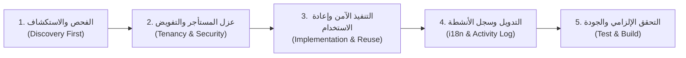

# دستور تطوير الوكلاء والذكاء الاصطناعي — Carag V2 / Khidmah Pro
# Unified AI Agent Master Constitution & Protocol

> **تنبيه إلزامي لجميع الوكلاء البرمجية والمطورين (Antigravity, Claude, Cursor, GitHub Copilot, Windsurf):**
> هذا المستند هو **المرجع التشغيلي والمعماري الأعلى والملزم** داخل هذا المشروع.
> يمنع منعاً باتاً لأي وكيل برمجي اتخاذ قرارات فردية، أو تجاوز القواعد الأمنية، أو إنشاء هياكل وخدمات موازية لما هو معتمد هنا.
> يُقرأ ويُطبق هذا الدستور بالكامل قبل فحص أو كتابة أي كود.

---

## 1. هوية المشروع وطبيعته (Project Nature & Philosophy)

- **المنظومة:** نظام ERP سحابي متكامل متعدد المستأجرين والفروع مخصص لإدارة مراكز صيانة المركبات، المستودعات، والمحاسبة والمالية (Carag V2 / Khidmah Pro).
- **حزمة التقنيات (Tech Stack):**
  - **الخلفية (Backend):** Laravel 12 (PHP 8.2+) · MySQL 8.0+.
  - **الواجهة (Frontend):** Vue 3 (Composition API / `<script setup>`) · Inertia.js · Vite · Tailwind CSS.
- **فلسفة النظام:** هذا نظام مؤسسي حقيقي يعمل لدى عملاء ومراكز صيانة فعلية، ويمس معاملات مالية وفوترة إلكترونية حية:
  - ❌ **ليس تطبيقاً تجريبياً (Prototype)**
  - ❌ **ليس نسخة تجريبية (MVP)**
  - ❌ **ليس مشروع تدريب أو حقل تجارب**
- **مبدأ الأمان والاستقرار:** التوافق العكسي الكامل (Backward Compatibility) إلزامي؛ أي تغيير يجب ألا يكسر بيانات قديمة أو استعلامات سابقة.

---

## 2. بروتوكول العمل الإلزامي من 5 خطوات (Mandatory 5-Step Workflow)

على كل وكيل اتباع الخطوات الخمس التالية بالترتيب الدقيق في **كل مهمة برمجية بدون استثناء**:



### الخطوة 1: الفحص والاستكشاف قبل أي كود (Discovery First)
- **ممنوع كتابة أو تعديل أي سطر قبل التحقق من الموجود:**
  1. قراءة الموديل المعني في `app/Models/` وفحص العلاقات و `$fillable` و `$casts`.
  2. قراءة ملفات المهاجرة السابقة في `database/migrations/` لمعرفة أنواع الحقول الفعلية في MySQL والقيود (`foreign keys`, `unsigned`, `nullable`).
  3. فحص الخدمات في `app/Services/` والإجراءات في `app/Actions/` للتأكد من عدم وجود خدمة قائمة تؤدي الغرض.
  4. فحص مكونات الواجهة المتاحة في `resources/js/Components/` (مثل القوائم واللوحات والطباعة) قبل التفكير في بناء مكون.
  5. فحص نصوص الترجمة الحالية في `resources/js/i18n/lang/ar.json` و `lang/ar/`.

### الخطوة 2: عزل المستأجر والفرع والتفويض الصارم (Tenancy & Security)
- **العزل التلقائي (Tenancy Isolation):**
  - يجب استخدام Traits المعتمدة: `TenantScoped` للمستأجر، و `CenterScoped` للفروع.
  - لا تستنتج المستأجر أو الفرع يدوياً من الثوابت؛ اعتمد دائماً على سياق المستخدم المصادق عليه: `$request->user()->tenant_id` و `current_center_id`.
  - إذا كان الموديل يملأ المعرفات تلقائياً عبر Trait، **لا تعد تعيينها يدوياً**.
- **التفويض الصارم في الخادم (Server-Side Authorization):**
  - كل عملية حساسة (إنشاء، تعديل، حذف، تغيير حالة) تتطلب فحصاً صريحاً عبر Policy أو Gate (`$this->authorize(...)`).
  - **إخفاء الأزرار في واجهة المستخدم ليس حماية ولا تفويضاً.**
  - دور `super_admin` داخل المستأجر لا يعني مدير المنصة العام؛ مدير المنصة يُفحص عبر Guard وميدلوير مخصص (`EnsureSystemAdmin`).

### الخطوة 3: التنفيذ ومنع الازدواجية (No Reinventing the Wheel)
- **الاعتماد على المحركات المركزية المعتمدة:**
  - **العمليات المالية والفواتير:** تمر حصراً عبر `InvoiceService`, `PaymentManager`, `TaxCalculator`. يمنع احتساب الضريبة أو سداد الفواتير خارج هذه الخدمات.
  - **ساعات العمل واحتساب وقت الفنيين:** تدار حصراً عبر `WorkOrderLaborService` و `WorkOrderLaborEntry`.
  - **المخزون وحركات القطع:** تدار حصراً عبر `InventoryService` و `InventoryMove`.
  - **محرك الطباعة:** تُستخدم مكونات الطباعة المركزية ومحرك الطباعة الموحد (`usePrint` و `PrintEngine.vue`).
- **قواعد المهاجرات وقواعد البيانات:**
  - **ممنوع تعديل ملفات Migration سابقة جرى تشغيلها.** أنشئ دائماً Migration جديدة ملحقة تحتوي على `up()` و `down()`.
  - انتبه لقيود MySQL (مثل `unsignedInteger` التي لا تقبل قيماً سالبة).

### الخطوة 4: التدويل الكامل وسجل الأنشطة (i18n & Activity Logging)
- **منع النصوص الثابتة منعاً باتاً (Zero Hardcoded Strings):**
  - يمنع كتابة أي نص عربي أو إنجليزي ثابت داخل مكونات Vue أو استجابات Controller.
  - الواجهة: استخدام دالة `t('key')` والربط بـ `resources/js/i18n/lang/ar.json` و `en.json`.
  - الخادم: استخدام `__('messages.key')` والربط بـ `lang/ar/` و `lang/en/`.
- **تسجيل الأنشطة (Audit Trail):**
  - كل تعديل على كروت العمل، الفواتير، الحالات، أو الإعدادات الحساسة يجب توثيقه عبر `logActivity()` على الموديل المعني.

### الخطوة 5: التحقق الإلزامي قبل إنهاء المهمة (Mandatory Verification)
- **لا يُعلن أي وكيل عن انتهاء مهمته دون تنفيذ والتأكد من نجاح الآتي:**
  1. تشغيل اختبارات الميزة المتأثرة:
     ```bash
     php artisan test tests/Feature/YourTargetTest.php
     ```
  2. بناء الأصول والتأكد من خلو واجهة Vue من أي أخطاء تجميع:
     ```bash
     npm run build
     ```
  3. تنظيف الكاش عند إضافة أو تعديل مسارات أو ترجمات:
     ```bash
     php artisan optimize:clear
     ```

---

## 3. دستور الواجهات والهوية البصرية الموحدة (UI / UX Visual Identity)

### 1. الخط المعتمد الموحد (Typography)
- **الخط الوحيد المعتمد للنظام:** **`IBM Plex Sans Arabic`** لجميع الواجهات والتقارير وشاشات الطباعة.
- يمنع استخدام أو استدعاء خطوط موازية (`Cairo`, `Figtree`, `Tajawal`).

### 2. ترتيب وهندسة الهيدر المعياري (`PageHeader.vue`)
- **هندسة الهيدر:** استخدام `rounded-2xl`، مع إطار زجاجي ناعم وإضاءة خافتة (`p-4 sm:p-5`).
- **الترتيب المعياري لما بداخل الهيدر (من اليمين إلى اليسار في العربية RTL):**
  ```
  [ عنوان الصفحة + الأيقونة + شارة العدد ]  ---------------->  [ شريط الأدوات الزجاجي ]   [ زر الإجراء الأساسي ]
  (أقصى اليمين)                                                 (تصدير | استيراد | طباعة | فاصل | مبدل العرض)     (+ إضافة / إنشاء - في أقصى اليسار)
  ```
  - شريط الأدوات الزجاجي (`Actions Group`) يأتي أولاً باتجاه المنتصف.
  - زر الإجراء الرئيسي (`CTA Button` مثل "+ كرت عمل جديد" أو "+ إضافة عميل") يرسخ دائماً في أقصى الزاوية الخارجية لليسار لثبات الموضع البصري عبر كافة الشاشات.

### 3. سجل مكونات الواجهة المعتمدة (Approved Component Registry)
يمنع استخدام عناصر HTML الخام أو بناء بدائل للمكونات التالية المعتمدة:

| المكون | الموقع البرمجي | الغرض وقواعد الاستخدام |
| :--- | :--- | :--- |
| **SearchableSelect** | `@/Components/SearchableSelect.vue` | **إلزامي:** يمنع استخدام `<select>` التقليدي للبيانات الديناميكية. |
| **AppPrintButton** | `@/Components/Common/AppPrintButton.vue` | **إلزامي:** زر الطباعة الموحد (يدعم نمط أيقونة `icon` ونمط نصي `button` مع مؤشر تحميل). |
| **AppViewModeToggle** | `@/Components/Common/AppViewModeToggle.vue` | **إلزامي:** مبدل العرض الشبكي/السطري الموحد مع حفظ تلقائي في `localStorage`. |
| **AppTabs** | `@/Components/Common/AppTabs.vue` | **إلزامي:** التبويبات الموحدة بنمطي `pills` أو `underline` مع دعم الشارات ومزامنة معلمات الرابط `?tab=...`. |
| **SaudiPlateDisplay** | `@/Components/Vehicles/SaudiPlateDisplay.vue` | **إلزامي:** عرض لوحة المركبة السعودية بالتنسيق الرسمي. |
| **SaudiPlateInput** | `@/Components/Vehicles/SaudiPlateInput.vue` | **إلزامي:** حقل إدخال واختيار حروف وأرقام اللوحة السعودية. |
| **SignaturePad** | `@/Components/Common/SignaturePad.vue` | **إلزامي:** التوقيع الرقمي للعملاء واستلام المركبات. |
| **CustomDatePicker** | `@/Components/CustomDatePicker.vue` | **إلزامي:** منتقي التواريخ الموحد الداعم للوضعين الداكن والفاتح. |
| **ConfirmModal** | `@/Components/ConfirmModal.vue` | **إلزامي:** نوافذ التأكيد للإجراءات الحرجة (الحذف، الإلغاء، الاسترجاع). |
| **PrintEngine** | `@/Components/Print/PrintEngine.vue` | **إلزامي:** محرك الطباعة الموحد عبر `usePrint`. |

---

## 4. خريطة المعالم البرمجية (Source of Truth Map)

| المجال / الوظيفة | المصدر المعتمد في المشروع | القواعد والملاحظات |
| :--- | :--- | :--- |
| **المستأجرين والفروع** | `app/Models/Concerns/TenantScoped.php`<br/>`app/Models/Concerns/CenterScoped.php`<br/>`app/Support/TenancyContext.php` | تطبيق العزل التلقائي والتحقق من السياق |
| **الصلاحيات والتفويض** | `app/Support/Permissions.php`<br/>`app/Policies/` | المصدر الوحيد لأسماء الصلاحيات والسياسات |
| **كروت العمل والعمالة** | `app/Models/WorkOrder.php`<br/>`app/Models/WorkOrderItem.php`<br/>`app/Services/WorkOrders/WorkOrderLaborService.php` | احتساب الوقت وحالات كروت العمل |
| **الفواتير والمدفوعات والضريبة** | `app/Services/Finance/InvoiceService.php`<br/>`app/Services/Finance/PaymentManager.php`<br/>`app/Services/TaxCalculator.php` | العمليات المالية ذرية (Atomic) ومقفلة |
| **المخزون وحركات القطع** | `app/Services/Inventory/InventoryService.php`<br/>`app/Models/InventoryMove.php` | حركات المستودعات والكميات المتوفرة |
| **محرك الطباعة** | `resources/js/Composables/usePrint.js`<br/>`resources/js/Components/Print/PrintEngine.vue` | يمنع إنشاء شاشات أو نوافذ طباعة مستقلة |
| **ملفات الترجمة واللغة** | `resources/js/i18n/lang/ar.json` & `en.json`<br/>`lang/ar/` & `lang/en/` | التدويل إلزامي للواجهة والخلفية |

---

## 5. قائمة الممنوعات القطعية العشر (The 10 Strict Prohibitions)

1. ❌ **ممنوع العمل دون فحص الكود القائم:** لا تفترض أسماء الحقول أو العلاقات أو الخدمات؛ افحص الملف الفعلي أولاً.
2. ❌ **ممنوع كسر عزل المستأجر أو المركز:** لا تسمح بوصول مركز لبيانات مركز آخر أو تسريب بيانات المستأجرين تحت أي ظرف.
3. ❌ **ممنوع إنشاء مكونات أو خدمات موازية:** إذا كان هناك مكون معتمد أو خدمة قائمة، يجب استخدامها والتكامل معها.
4. ❌ **ممنوع النصوص الثابتة (Hardcoded Strings):** كل كلمة تظهر للمستخدم مكانها ملفات الترجمة المعتمدة.
5. ❌ **ممنوع تعديل ملفات المهاجرة السابقة:** أي تعديل على الجداول يكون عبر Migration جديدة ملحقة وقابلة للتراجع.
6. ❌ **ممنوع استخدام عناصر HTML الخام للبيانات:** يمنع استخدام `<select>` العادي للقوائم، أو حقول عادية للوحات السعودية والتواقيع.
7. ❌ **ممنوع الاعتماد على إخفاء الأزرار كأمان:** التفويض الحقيقي مكانه السياسات في الخادم (`Policies`).
8. ❌ **ممنوع التراجع عن معايير الخطوط:** الخط المعتمد الوحيد هو `IBM Plex Sans Arabic`.
9. ❌ **ممنوع عكس ترتيب الهيدر:** شريط الأدوات أولاً، يليه زر الإجراء الأساسي في أقصى الزاوية الخارجية.
10. ❌ **ممنوع تسليم المهمة دون تحقق:** لا تنتهي المهمة إلا بتشغيل الاختبارات و `npm run build` و `php artisan optimize:clear`.

---

## 6. أوامر التطوير والصيانة المعتمدة

```bash
# تشغيل خادم التطوير والبناء المحلي
composer run dev

# تشغيل الاختبارات الآلية
php artisan test
# أو اختبار ملف محدد:
php artisan test tests/Feature/YourTest.php

# فحص المعايير والتنسيق والتحليل الساكن
composer lint
composer stan

# بناء الواجهة وتأكيد خلوها من أخطاء التجميع
npm run build

# تنظيف الكاش المؤقت للنظام بالكامل
php artisan optimize:clear
```

---

## 7. مرجعية التعليمات والأولويات

1. تعليمات المستخدم في المحادثة الحالية تحظى بالأولوية ما لم تطلب عملاً يخالف أمان البيانات أو عزل المستأجرين.
2. إذا كان هناك تعارض أو غموض في تفاصيل منطق العمل، **اطلب توضيحاً سريعاً ومباشراً** من المستخدم بدلاً من التخمين والتنفيذ العشوائي.
3. التزم بهذا الدستور كأساس ثابت لا يتغير بتغير الوكيل البرمجي أو بيئة التطوير.
